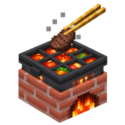
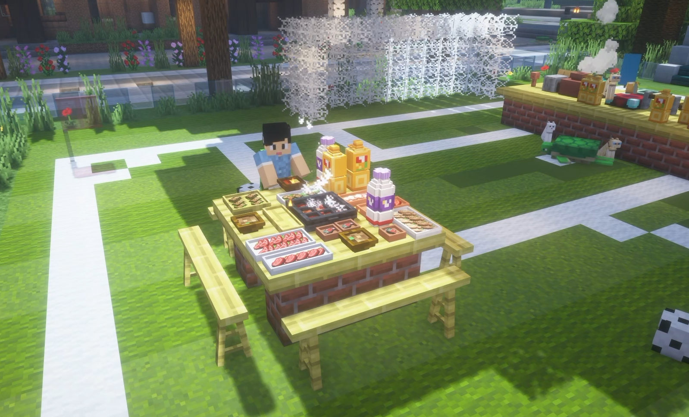
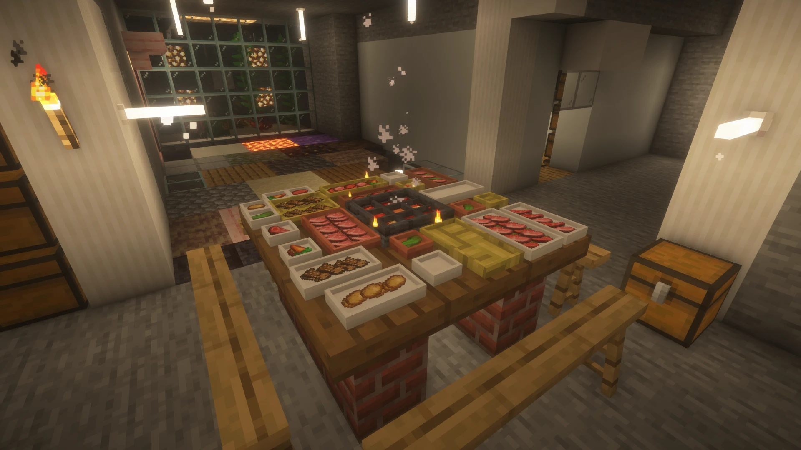

# 之晗的火锅物语 · Orient's Hotpot Chronicles

在 Minecraft 里吃一顿九宫格火锅：砌灶台、坐上锅、倒汤底、点火，把食材下锅涮熟，再用筷子夹着吃。

Cook a nine-grid hotpot in Minecraft: build a stove, seat a pot on it, pour in a broth, light the fire, cook your food and eat it with chopsticks.

Minecraft 1.21.1 · Fabric · 作者 / Author：蘧白川 / Orient（GitHub：[@mryt233](https://github.com/mryt233)）

> [!WARNING]
> **测试版（alpha）**：现在是 `0.1.1-alpha`，可能有 bug。请先在新存档里试玩，并备份你的存档。
> **从 0.1.0-alpha.1 升级**：本次有多项不兼容的物品 / 方块 ID 调整，旧存档中本模组的物品和方块可能丢失或发生变化。请备份存档，并在新存档里玩。
>
> **Alpha version**: this is `0.1.1-alpha` and may contain bugs. Please try it in a new world first and back up your saves.
> **Upgrading from 0.1.0-alpha.1**: this version includes incompatible item and block ID changes. This mod's items and blocks in old worlds may be lost or change. Back up your saves and use a new world.

## 截图 · Screenshots

*碗、饮料等从 `0.1.1-alpha` 起包含。 · Bowls and drinks are included from `0.1.1-alpha`.*

<!-- 截图：九宫格锅界面 -->
<!-- 截图：盘子里叠着的菜（特写） -->
<!-- 截图：创造模式物品栏分类页 -->

## 特色 · Features

- **灶台和锅**：灶台用原版熔炉燃料烧火，铁锅、铜锅坐在灶台上煮。还有 1.5 格高的高灶台，配高火锅桌用。
- **四种汤底**：清汤（水桶）、浓汤（牛奶桶）、菌汤（蘑菇煲）、红汤（岩浆桶）。汤底不同，煮的快慢也不同：红汤最快，浓汤最慢。
- **9×9 = 81 格的九宫格锅**：生食材下锅，按熔炉配方的时间煮熟，熟了拿出来能得到和熔炉一样的经验。
- **竹筷**：在锅界面里用筷子左键点熟食，直接吃掉；也能从盘子里夹菜、把菜放进锅里。
- **趁热吃**：锅不在烧着的灶台、点燃的篝火或灵魂篝火上时就是冷锅，吃冷锅里的东西有概率反胃。
- **围锅取暖**：灶台烧着火、上面有锅，或锅放在点燃的篝火、灵魂篝火上时，6 格内的玩家获得生命恢复 I。
- **不白烧燃料**：只有在煮生食材时才消耗燃料，光烧着保温不耗。
- **整锅带走**：挖下来的锅连汤带菜，放下来原样都在。
- **火锅桌**：11 种原版木头，各有矮桌和高桌，互相拼接，也能和灶台拼成一整张大桌。
- **板凳和条凳**：11 种木头，同方向挨着放会连成长凳，能坐。
- **盘子**：石英、竹编、红陶、铜、铁 5 种材质 × 6 种大小，摆在桌上放菜，一格能叠 3 样。
- **毛肚**：牛和哞菇会掉生毛肚，在锅里涮得比牛肉快。
- **碗**：原版的碗能摆在桌上装菜，能从锅里盛熟菜，锅里没有熟菜时还能盛一碗汤喝：清汤解反胃，浓汤更顶饱，菌汤给生命恢复，红汤给力量（但会有点饿）。
- **饮料**：橙子饮料、植物蛋白饮料，一瓶喝 4 口，都能解红汤的饥饿；橙子饮料加速，植物蛋白饮料解反胃。能摆在桌上。暂时只能在创造模式拿到。
- **篝火煮锅**：锅放在点着的篝火、灵魂篝火上也能煮，速度和灶台一样，不耗燃料，也给周围的人回血。
- **桌面摆件**：灯笼、花盆、蜡烛、蛋糕等小摆件放在火锅桌上会贴住桌面。
- **10 种语言**：简体中文、繁体中文、英语、日语、韩语、俄语、德语、法语、西班牙语、葡萄牙语（巴西）。

---

- **Stove and pots**: the stove burns vanilla furnace fuel; seat an iron or copper pot on it to cook. A 1.5-block Tall Brick Stove matches the tall hotpot tables.
- **Four broths**: Clear (water bucket), Milky (milk bucket), Mushroom (mushroom stew), Spicy (lava bucket). Each broth cooks at a different speed: Spicy is the fastest, Milky the slowest.
- **A 9×9 = 81-slot nine-grid pot**: raw food cooks in the time its furnace recipe takes, and gives the same XP as a furnace.
- **Bamboo Chopsticks**: in the pot screen, left-click cooked food with the chopsticks to eat it on the spot. They also pick food up from plates and put food into the pot.
- **Eat it hot**: a pot that is not on a lit stove, campfire or soul campfire is a cold pot. Eating from a cold pot may give you Nausea.
- **Warm up around the pot**: a pot on a lit stove, campfire or soul campfire gives Regeneration I to players within 6 blocks.
- **No wasted fuel**: fuel is only used while raw food is cooking. Keeping the pot hot costs nothing.
- **Take the whole pot with you**: a mined pot keeps its broth and food. Place it down and everything is still there.
- **Hotpot tables**: 11 vanilla wood types, each in a low and a tall version. Tables connect to each other and to the stove into one big table.
- **Stools and benches**: 11 wood types. Placed side by side facing the same way, they join into a long bench you can sit on.
- **Plates**: 5 materials (quartz, bamboo, terracotta, copper, iron) × 6 sizes. Put them on the table and stack up to 3 foods in each slot.
- **Tripe**: cows and mooshrooms drop Raw Tripe, which cooks in the pot faster than beef.
- **Bowls**: vanilla bowls can be placed on tables to hold food, scoop cooked food out of the pot, or, when the pot has no cooked food, scoop a bowl of broth to drink: Clear cures Nausea, Milky is more filling, Mushroom gives Regeneration, Spicy gives Strength (and a little Hunger).
- **Drinks**: Orange Drink and Plant Protein Drink, 4 sips per bottle. Both cure the Hunger from spicy broth; Orange Drink gives Speed, Plant Protein Drink cures Nausea. They can be placed on tables. Creative-only for now.
- **Campfire cooking**: a pot on a lit campfire or soul campfire cooks at stove speed, uses no fuel, and also heals nearby players.
- **Table decorations**: lanterns, flower pots, candles, cakes and other small decorations sit flush on hotpot tables.
- **10 languages**: English, Simplified Chinese, Traditional Chinese, Japanese, Korean, Russian, German, French, Spanish, Portuguese (Brazil).

## 版本支持 · Compatibility

| 项目 · Item | 要求 · Required | 作者测试用的版本 · Tested with |
| --- | --- | --- |
| Minecraft | 只支持 **1.21.1** · **1.21.1** only | 1.21.1 |
| 加载器 · Loader | **Fabric**（没有 Forge / NeoForge 版 · no Forge / NeoForge version） | — |
| Fabric Loader | **0.15.11** 或更新 · or newer | 0.19.3 |
| Fabric API | **1.21.1 版**，建议 0.116.14+1.21.1 或更新 · for 1.21.1, 0.116.14+1.21.1 or newer recommended | 0.116.14+1.21.1 |
| Java | **21** 或更新 · or newer | 21 |
| 安装位置 · Side | **客户端和服务端都要装** · **both client and server** | — |

### 和其他模组的兼容性 · Compatibility with other mods

**不详。** 目前还在适配，还没有专门测试过和其他模组一起装的情况。如果你发现和某个模组冲突（崩溃、显示不对、功能失效），欢迎[反馈](#反馈--feedback)！

**Unknown.** Still being worked on; it has not been tested together with other mods yet. If you run into a conflict with another mod (crash, visual glitch, broken feature), please [let me know](#反馈--feedback)!

## 安装 · Installation

1. 安装 [Fabric Loader](https://fabricmc.net/use/)（Minecraft 1.21.1，Loader 0.15.11 或更新）。
2. 下载 [Fabric API](https://modrinth.com/mod/fabric-api)（1.21.1 版），放进 `mods` 文件夹。
3. 从 [Releases](https://github.com/mryt233/Orients-Hotpot-Chronicles/releases) 下载本模组的 jar，放进 `mods` 文件夹。

需要 **Java 21**。**客户端和服务端都要装。**

---

1. Install [Fabric Loader](https://fabricmc.net/use/) for Minecraft 1.21.1 (Loader 0.15.11 or newer).
2. Download [Fabric API](https://modrinth.com/mod/fabric-api) for 1.21.1 and put it in your `mods` folder.
3. Download this mod's jar from [Releases](https://github.com/mryt233/Orients-Hotpot-Chronicles/releases) and put it in your `mods` folder.

Requires **Java 21**. **Install it on both the client and the server.**

## 怎么玩 · How to play

<b>展开中文玩法</b>

1. **摆灶台、坐锅**：拿锅右键灶台顶面，锅的两只耳朵会朝向你的左右两边。
2. **倒汤底**：拿着水桶、牛奶桶、蘑菇煲或岩浆桶右键锅。换汤底前，先用空桶右键清空旧汤底：清汤、浓汤、红汤会返还对应的桶；菌汤会被倒掉，不返还蘑菇煲，手里仍是空桶。锅里原有的食材会掉出来。用碗盛菜或盛汤不会清空锅中的汤底。
3. **点火**：打开灶膛放燃料。锅里有汤、灶膛有燃料就会点着、沸腾。只有在煮生食材时才消耗燃料。
4. **下菜**：
   - 拿食材右键锅；或者用筷子打开锅界面，往 81 格里放；
   - 筷子夹着菜右键锅，菜会放进准星对着的那个大格；
   - 拿着装了菜的盘子右键锅，生食材会整盘倒进去，随机分到各个大格，熟的留在盘子里。

   能下锅的是生的、能吃的东西，熟了的不能再下锅。
5. **吃**：在锅界面里把筷子拿到鼠标上，左键点熟食就能吃掉，饱食度和原版一样。空手或拿碗右键锅，也能把熟食捞出来。
6. **趁热吃**：锅不在烧着的灶台或篝火上就是冷锅，吃冷锅里的东西有概率反胃。
7. **围锅取暖**：灶台烧着火、上面有锅时（锅放在点着的篝火上也算），6 格内的玩家获得生命恢复 I。
8. **整锅带走**：对着锅挖只挖锅，对着灶身挖会挖掉整个灶台。汤和菜都装在锅物品里，放下来原样都在，物品提示里写着汤底和份数。
9. **盘子**：
   - 拿盘子右键桌面或地面摆上去，一格能摆好几个（比如 5 个小碟、2 个长盘，或者混着摆）；
   - 拿食物右键盘子放菜，每一格能叠 3 样；
   - 筷子右键盘子，夹走最后放上去的那样，再右键放回盘子或放进锅；
   - 空手右键拿起整个盘子，菜跟着走；潜行 + 空手右键一次取出一样菜；
   - 挖只挖准星对着的那个盘子；鼠标中键能连菜一起复制盘子；
   - 装了菜的盘子，物品提示里会像收纳袋一样列出里面的菜。
10. **坐**：空手右键板凳或条凳坐下，点两块凳子的交界处能坐在中间，潜行起身。两个人之间至少隔一整格。
11. **毛肚**：打牛或哞菇掉 1～3 个生毛肚（和原版牛肉一样：抢夺能多掉，着火时掉熟的）。
12. **碗**：空碗右键锅，优先盛准星所指大格的熟菜，不足时继续从其他大格取，每碗最多 3 份。全锅没有熟菜但有汤时，盛一碗汤，对着空气右键就能喝。拿碗右键桌面能摆上去，像盘子一样放菜；装了菜的碗右键锅，会把生菜倒进锅里。
13. **饮料**：对着空气右键喝一口，一瓶 4 口，喝完剩空瓶。拿饮料右键桌面能摆上去。
14. **篝火煮锅**：把锅直接放在点着的篝火或灵魂篝火上，倒汤下菜就能煮，不用燃料。

创造模式里有单独的分类页「之晗的火锅物语」，左边能切换子类：全部、厨具、餐具、桌子、凳子、食物。

<b>How to play (English)</b>

1. **Stove and pot**: right-click the top of a stove with a pot. The pot's two handles face your left and right.
2. **Broth**: right-click the pot with a water bucket, milk bucket, mushroom stew or lava bucket. Before changing broth, empty the pot with an empty bucket. Clear, Milky and Spicy return the corresponding filled bucket; Mushroom is discarded without returning mushroom stew, and the bucket stays empty. Any food in the pot drops out. Serving food or broth with a bowl does not empty the pot's broth.
3. **Fire**: open the stove and put in fuel. With broth in the pot and fuel in the stove, it lights and boils. Fuel is only used while raw food is cooking.
4. **Adding food**:
   - right-click the pot with food, or open the pot screen with chopsticks and put food into the 81 slots;
   - right-click the pot with chopsticks holding food to put it into the big cell you are aiming at;
   - right-click the pot with a plate of food to pour all the raw food in, spread randomly across the big cells. Cooked food stays on the plate.

   Only raw, edible items can go in. Cooked food can't go back in.
5. **Eating**: in the pot screen, hold the chopsticks on your cursor and left-click cooked food to eat it, with the same hunger and saturation as vanilla. Right-clicking the pot with an empty hand or a bowl also takes cooked food out.
6. **Eat it hot**: a pot that is not on a lit stove or campfire is a cold pot. Eating from a cold pot may give you Nausea.
7. **Warm up**: a lit stove with a pot on it (or a pot on a lit campfire) gives Regeneration I to players within 6 blocks.
8. **Take the whole pot**: aim at the pot to mine only the pot; aim at the stove body to mine the whole stove. The broth and food are kept in the pot item and come back when you place it. The tooltip shows the broth and the number of servings.
9. **Plates**:
   - right-click a table top or the ground with a plate to place it. One block can hold several plates (for example 5 small dishes, 2 long plates, or a mix);
   - right-click a plate with food to put it on. Each slot stacks up to 3 foods;
   - right-click a plate with chopsticks to pick up the last food placed, then right-click to put it back or into the pot;
   - right-click with an empty hand to pick up the whole plate with its food; sneak + right-click with an empty hand to take out one food at a time;
   - mining only breaks the plate you are aiming at; middle-click copies a plate together with its food;
   - a plate with food lists its contents in the tooltip, like a bundle.
10. **Sitting**: right-click a stool or bench with an empty hand to sit. Click where two seats meet to sit in the middle. Sneak to stand up. Two players sit at least one full block apart.
11. **Tripe**: cows and mooshrooms drop 1–3 Raw Tripe (like vanilla beef: Looting adds more, and they drop cooked if on fire).
12. **Bowls**: right-click the pot with an empty bowl to scoop up to 3 cooked food items, starting with the big cell you are aiming at and continuing through the other cells if needed. If the whole pot has no cooked food but has broth, you get a bowl of broth, which you drink by right-clicking the air. Right-click a table top to place a bowl and put food in it like a plate; right-clicking the pot with a bowl of food pours the raw food in.
13. **Drinks**: right-click the air to take a sip; 4 sips per bottle, leaving an empty bottle. Right-click a table top to place a drink.
14. **Campfire cooking**: place the pot directly on a lit campfire or soul campfire, add broth and food, and it cooks without fuel.

In Creative mode, the mod has its own tab, "Orient's Hotpot Chronicles", with sub-categories on the left: All, Cook, Dish, Table, Seat, Food.

## 合成表 · Recipes

除了熟毛肚，都在工作台合成。表里的「空」表示那一格不放东西。

All recipes use a crafting table except Cooked Tripe. "空 / empty" means leave that slot empty.

| 物品 · Item | 配方 · Recipe | 产出 · Output |
| --- | --- | --- |
| 灶台 · Brick Stove | 上排：圆石 ×3；下排：圆石、熔炉、圆石 Top: 3 cobblestone; bottom: cobblestone, furnace, cobblestone | 1 |
| 高灶台 · Tall Brick Stove | 灶台 + 红砖块（无序） Stove + bricks (shapeless) | 1 |
| 铁制九宫格火锅 · Iron Nine-Grid Hotpot | 一排：铁锭、炼药锅、铁锭 One row: iron ingot, cauldron, iron ingot | 1 |
| 铜制九宫格火锅 · Copper Nine-Grid Hotpot | 上排：铜锭、空、铜锭；下排：铜锭、炼药锅、铜锭 Top: copper ingot, empty, copper ingot; bottom: copper ingot, cauldron, copper ingot | 1 |
| 竹筷 · Bamboo Chopsticks | 2×2 竹子 2×2 bamboo | 1 |
| 火锅桌 · Hotpot Table | 同种木板 ×8 围一圈，中间放 1 个红砖 8 planks of one wood type around 1 brick | 4 |
| 高火锅桌 · Tall Hotpot Table | 上排：同种木板 ×3；下排：红砖块 ×3 Top: 3 planks; bottom: 3 bricks | 3 |
| 板凳 · Stool | 上排：同种木板 ×3；下排：木棍、空、木棍 Top: 3 planks; bottom: stick, empty, stick | 3 |
| 条凳 · Bench | 上排：同种木板 ×3；下面两排：木棍、空、木棍 Top: 3 planks; next two rows: stick, empty, stick | 3 |
| 小碟 · Small Dish | 一排 2 个：下界石英 / 竹子 / 红砖 / 铜锭 / 铁锭 2 in a row: nether quartz / bamboo / brick / copper ingot / iron ingot | 2 |
| 双格盘 · Two-Slot Plate | 同材质小碟 ×2 横排 2 small dishes of the same material in a row | 1 |
| 三格长盘 · Three-Slot Long Plate | 同材质小碟 ×3 横排 3 small dishes in a row | 1 |
| 四格方盘 · Four-Slot Square Plate | 同材质小碟 2×2 2×2 small dishes | 1 |
| 五格长盘 · Five-Slot Long Plate | 上排：小碟、空、小碟；下排：小碟 ×3 Top: dish, empty, dish; bottom: 3 dishes | 1 |
| 八格大盘 · Eight-Slot Platter | 同材质小碟 ×8 围一圈，中间空 8 small dishes in a ring, center empty | 1 |
| 熟毛肚 · Cooked Tripe | 熔炉、烟熏炉或营火烤生毛肚 Smelt Raw Tripe in a furnace, smoker or campfire | 1 |

## 许可证 · License

《之晗的火锅物语》（Orient's Hotpot Chronicles）采用双许可证：

- **源代码 / Source code**：[MIT License](LICENSE) — 允许按照 MIT 条款使用、修改、移植和分发代码，包括商业使用；须保留版权和许可证声明。
- **原创非代码资源 / Original non-code assets**：[CC BY-NC-SA 4.0](ASSETS_LICENSE) — 原创贴图、模型、音效等允许依照协议非商业分享和改编，须署名并遵守相同方式共享条款。

编译后的 Mod JAR 可能同时包含代码和资源，两类内容分别受对应许可证约束。Minecraft 原版及第三方素材不属于本项目可自行授权的范围，仍遵循原权利人的条款。

The project uses separate licenses:

- **Source code:** [MIT License](LICENSE). Use, modification, ports, redistribution, and commercial use are permitted subject to the MIT terms, including retention of copyright and license notices.
- **Original non-code assets:** [CC BY-NC-SA 4.0](ASSETS_LICENSE). Original textures, models, sounds, and other creative assets may be shared and adapted for noncommercial purposes under its attribution and ShareAlike terms.

A compiled mod JAR may contain both code and assets; each part retains its applicable license. Minecraft and third-party materials are excluded from these grants and remain under their respective owners' terms.

Copyright © 2026 蘧白川 / Orient (GitHub: [mryt233](https://github.com/mryt233)).

## 反馈 · Feedback

遇到 bug、有疑问或建议，欢迎告诉我：

- **GitHub Issues**：[提交反馈](https://github.com/mryt233/Orients-Hotpot-Chronicles/issues/new/choose)（有报 bug、提建议、提问三种表单）
- **B 站**：蘧白川
- **邮箱**：orientcheung233@gmail.com
- **QQ 交流群**：248314791（作者没回就是在睡觉）

Found a bug, or have a question or an idea? Let me know:

- **GitHub Issues**: [open an issue](https://github.com/mryt233/Orients-Hotpot-Chronicles/issues/new/choose) (bug report, suggestion, or question)
- **Bilibili**: 蘧白川
- **Email**: orientcheung233@gmail.com
- **QQ group**: 248314791（If I’m not replying, I’m probably asleep）

<!-- Modrinth 尚在审核；通过审核且项目公开可访问后补链接。CurseForge / MC百科 上架后再补链接。 -->

## 作者 · Credits

蘧白川 / Orient · GitHub：[@mryt233](https://github.com/mryt233)
