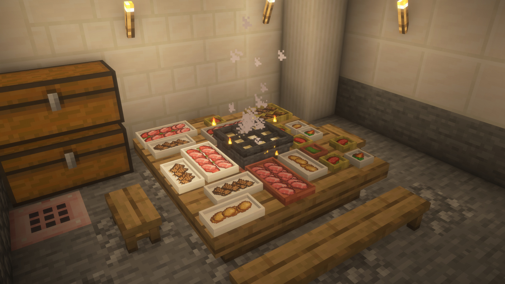
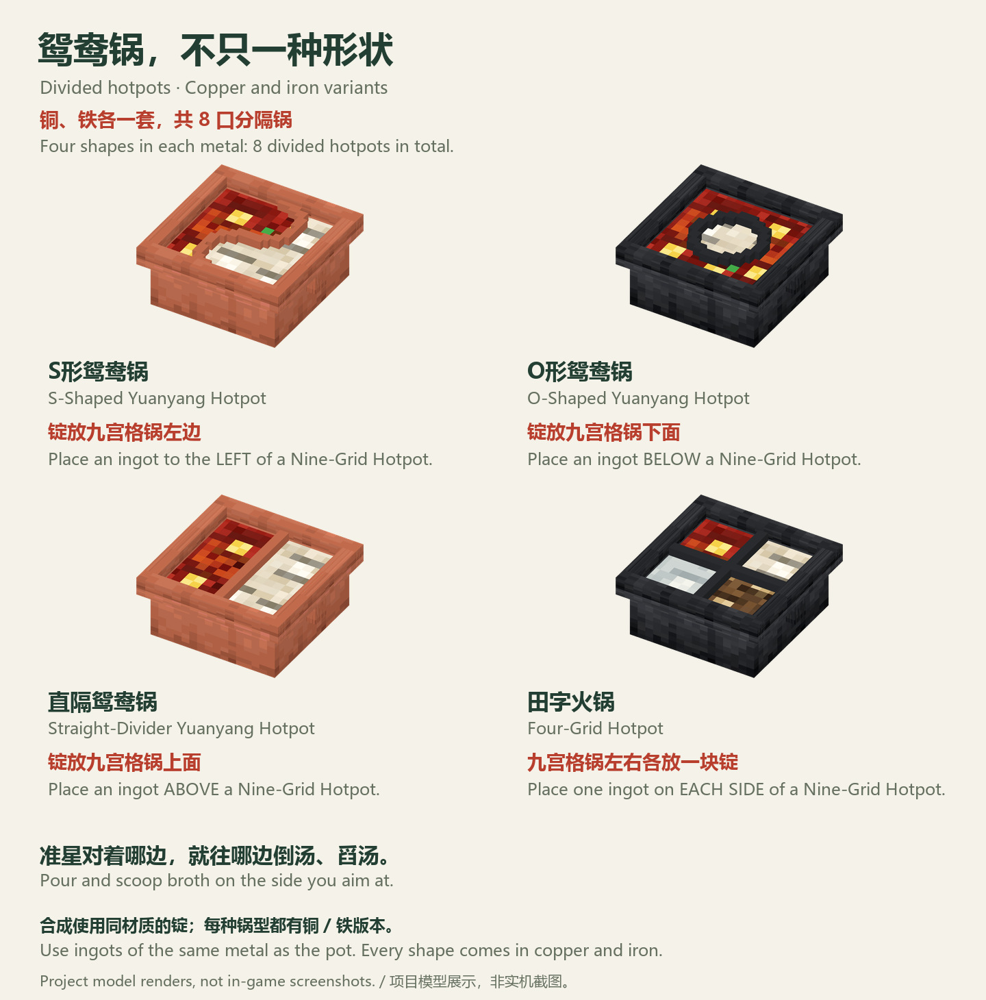
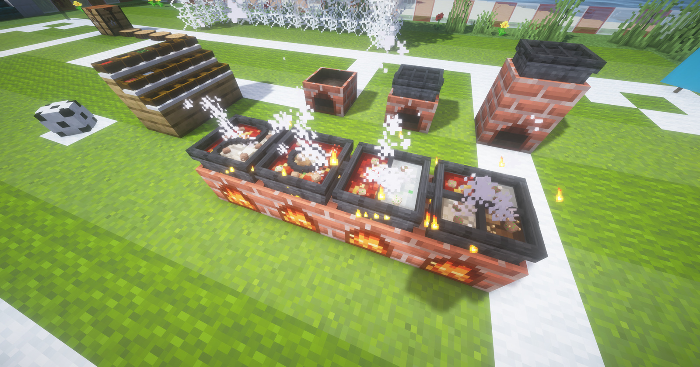
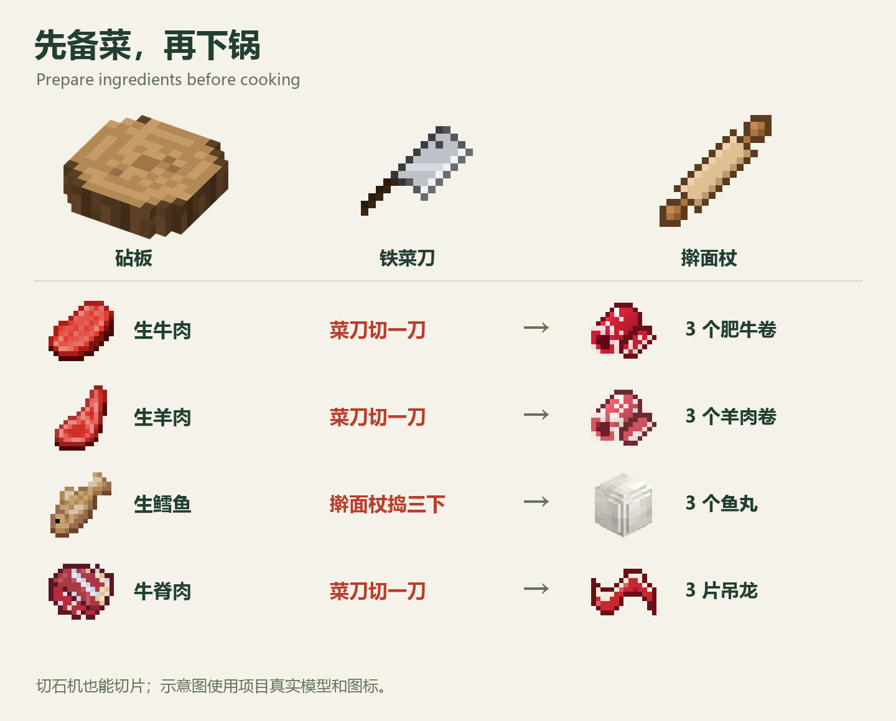
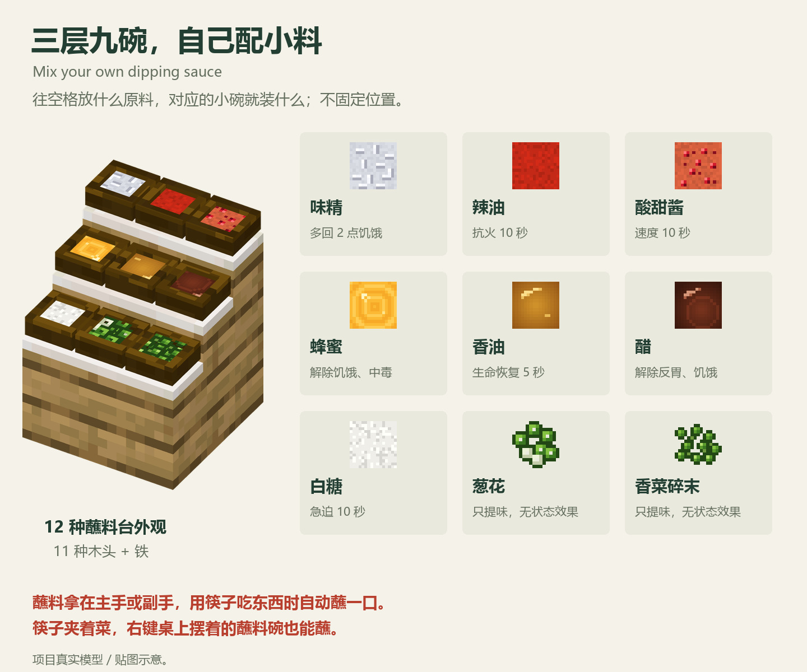
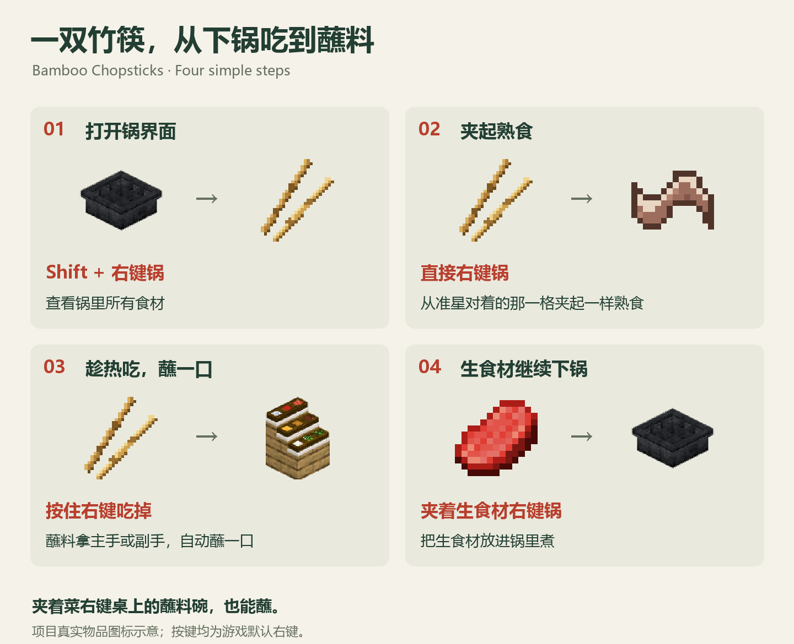
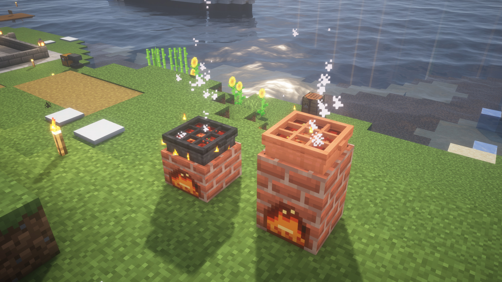
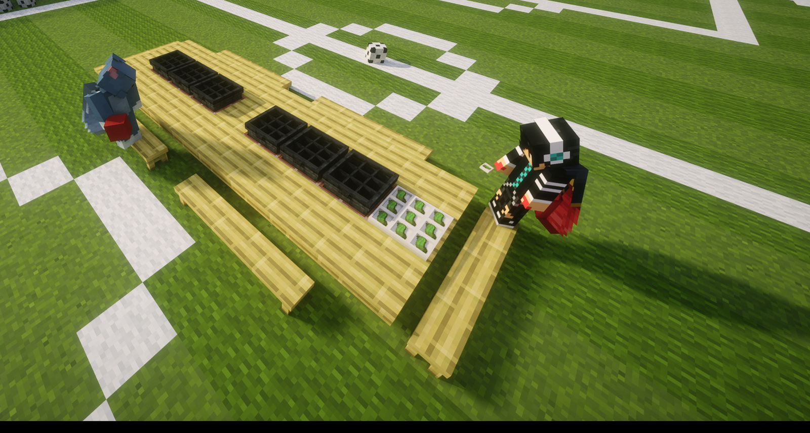
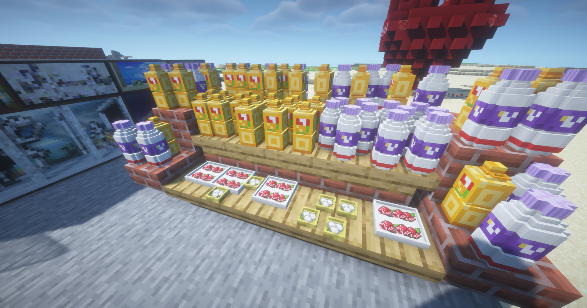
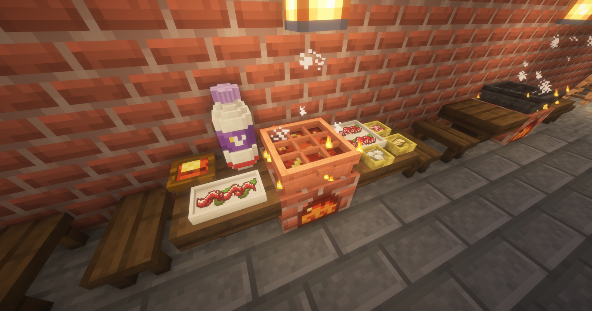

# 之晗的火锅物语 · Orient's Hotpot Chronicles

在 Minecraft 里吃一顿火锅：砌灶台、坐上锅、倒汤底、点火，备菜下锅涮熟，再用筷子蘸着料吃。

Have a hotpot dinner in Minecraft: build a stove, seat a pot on it, pour in a broth, light the fire, prep your ingredients, cook them and eat them with chopsticks and dipping sauce.

Minecraft 1.20.1 / 1.20.4 / 1.21.1 · Fabric / Forge / NeoForge · 作者 / Author：蘧白川 / Orient（GitHub：[@mryt233](https://github.com/mryt233)）

[中文图文教程](https://mryt233.github.io/Orients-Hotpot-Chronicles/zh-cn/) / [繁中圖文教學](https://mryt233.github.io/Orients-Hotpot-Chronicles/zh-tw/) / [English Guide](https://mryt233.github.io/Orients-Hotpot-Chronicles/en/) · [下载测试版 · Download Alpha](#downloads) · [更新日志 · Changelog](https://github.com/mryt233/Orients-Hotpot-Chronicles/releases) · [反馈问题 · Report an Issue](https://github.com/mryt233/Orients-Hotpot-Chronicles/issues/new/choose)

> [!WARNING]
> **测试版（alpha）**：现在是 `0.1.4-alpha`，可能有 bug，请备份存档。
> **请开新存档**：本版鸳鸯锅改名并更新内部 ID，**旧存档中放置的 S 形、O 形铜锅与铁锅会消失**。
>
> **Alpha version**: this is `0.1.4-alpha` and may contain bugs. Please back up your saves.
> **Please start a new world**: Yuanyang pot IDs were renamed. **Placed S-shaped and O-shaped copper and iron pots will disappear in existing worlds.**

## 下载 · Downloads

请按 Minecraft 版本和加载器下载对应文件，客户端和服务端都要装。 / Choose the file matching your Minecraft version and loader, and install it on both client and server.

| Minecraft | 加载器 / Loader | 要求 / Requirements | 模组版本 / Mod version | 下载 / Download |
| --- | --- | --- | --- | --- |
| 1.21.1 | Fabric | Fabric Loader 0.15.11+、[Fabric API](https://modrinth.com/mod/fabric-api)、Java 21 | 0.1.4-alpha | [下载 / Download](https://github.com/mryt233/Orients-Hotpot-Chronicles/releases/tag/v0.1.4-alpha) |
| 1.21.1 | NeoForge | NeoForge 21.1.264+、Java 21 | 0.1.4-alpha | [下载 / Download](https://github.com/mryt233/Orients-Hotpot-Chronicles/releases/tag/v0.1.4-alpha) |
| 1.20.1 | Fabric | Fabric Loader **0.19.3+**、[Fabric API](https://modrinth.com/mod/fabric-api) **0.92.12+**、Java 17 | 0.1.4-alpha | [下载 / Download](https://github.com/mryt233/Orients-Hotpot-Chronicles/releases/tag/v0.1.4-alpha) |
| 1.20.1 | Forge | Forge 47.1+、Java 17（同一文件也能装在 NeoForge 1.20.1 上 / also loads on NeoForge 1.20.1） | 0.1.4-alpha | [下载 / Download](https://github.com/mryt233/Orients-Hotpot-Chronicles/releases/tag/v0.1.4-alpha) |
| 1.20.4 | Fabric | Fabric Loader 0.15.11+、Fabric API、Java 17 | 0.1.1-alpha | [下载 / Download](https://github.com/mryt233/Orients-Hotpot-Chronicles/releases/tag/v0.1.1-alpha-mc1.20.4-fabric) |

四个 0.1.4-alpha 文件都在同一个发布页里，请下载文件名里的 MC 版本和加载器都对得上的那个。Forge / NeoForge 版不需要 Fabric API。1.20.4 还停在 0.1.1-alpha，没有 0.1.2 之后的内容。

All four 0.1.4-alpha files are on the same release page; pick the one whose file name matches your Minecraft version and loader. The Forge / NeoForge builds do not need Fabric API. Minecraft 1.20.4 is still on 0.1.1-alpha and has none of the content from 0.1.2 onward.

> 1.21.1 Fabric 是主版本，作者进游戏实测过；其他移植版做过服务端自动检查和客户端启动检查，右键交互、界面和画面还没有大量实测。与其他模组的兼容性也还没测过。欢迎反馈问题。
>
> 1.21.1 Fabric is the main build and was tested in game by the author. The ports passed automated server checks and client start-up checks, but right-click interactions, screens and visuals have not been widely tested. Compatibility with other mods has not been tested either. Bug reports are welcome.

[各版本源码与说明 · Port sources and notes](version-ports/README.md)

## 0.1.4-alpha 更新 · What's new

从 0.1.3-alpha-hotfix1 升级：虾、之晗可乐、玻璃杯、番茄 / 三鲜汤底、更多锅型、石料桌与交互修复。文件、依赖、测试范围及完整改动见[发布说明](https://github.com/mryt233/Orients-Hotpot-Chronicles/releases/tag/v0.1.4-alpha)。

Changes since 0.1.3-alpha-hotfix1: shrimp, Orient Cola, glass cups, Tomato and Three Delicacies broths, more pot layouts, stone tables and interaction fixes. See the [release notes](https://github.com/mryt233/Orients-Hotpot-Chronicles/releases/tag/v0.1.4-alpha) for files, requirements, testing and the full changelog.

## 0.1.3-alpha-hotfix1 更新 · What's new

0.1.3-alpha 没有单独发布，下面是从 0.1.2-alpha 到现在的全部更新。完整说明见[发布页](https://github.com/mryt233/Orients-Hotpot-Chronicles/releases/tag/v0.1.3-alpha-hotfix1)。

### 新内容

- **鸳鸯锅和田字锅**：铜、铁各 4 种——S 形鸳鸯锅、O 形鸳鸯锅、直隔鸳鸯锅、田字火锅。九宫格火锅 + 一块同材质的锭合成：锭放锅**左边**出 S 形，放**下面**出 O 形，放**上面**出直隔，**左右各一块**出田字。每一边放一种汤底，**准星对着哪边就往哪边倒汤、舀汤**，每格的菜用自己那边的汤煮；收起来后物品图标上看得到每边是什么汤。
- **牛脊肉和吊龙**：杀牛、哞菇有 **25%** 概率掉牛脊肉，能烤成熟牛脊肉（和熟牛排一样顶饱）；在砧板（菜刀切）或切石机上切成 3 片**吊龙**，是下锅涮得最快的食材。
- **筷子新玩法**：拿竹筷 **Shift + 右键**锅打开锅界面；**直接右键**锅，从准星对着的那一格夹起一样熟食，再**按住右键**吃掉；夹着生食材右键锅还是下锅煮。
- **蘸料更方便**：用筷子吃东西时，蘸料拿在**主手或副手**都会自动蘸一口；筷子夹着菜右键**桌上摆着的蘸料碗**也能蘸。
- **端走单独摆放的锅**：地上、篝火上的锅，**空手 Shift + 右键**整锅连汤带菜收进背包。

### 调整

- 「浓汤」改名「**高汤**」；9 种语言的翻译重新校对了一遍。
- 新配方：砧板 = 两个原木横排，出 2 个；5 种小碟 = 「材料 碗 材料」横排，出 2 个（以前的配方和原版冲突）。
- 篝火上的锅底加了四根铁支架，火苗不再穿进锅里；冷锅里的食材不再闪烁，改成慢慢上下漂。
- 条凳反着放也能连成长凳。
- 砧板有了朝向；挖板上的食物只挖食物、不会连砧板一起挖掉；拿在手里看得见，物品栏图标不再发暗。
- 擀面杖换成带把手的样子；橙子饮料瓶上半截也加了「回」字纹。
- 蘸料台矮了一个活板门的高度，选中框只框你对着的那个小碗。
- 火锅只收能吃的东西，木头、铁器不会再被放进锅里。
- 创造物品栏里锅的顺序：先铁锅后铜锅，每种按九宫格、S 形、O 形、直隔、田字排。

### 修复

- 筷子从桌上的碗、盘子里夹起熟食后，按住右键吃会被当成「放回去」，菜来回跳。
- 砧板上放不了土豆和豆腐（0.1.2-alpha 出的问题）；砧板拿空后东西还显示着。
- 用筷子吃东西时碎屑是紫黑方块；挖植物蛋白饮料飞出橙子饮料的碎屑；植物蛋白饮料瓶盖闪烁。
- 两处和原版冲突的配方：1 个原木做砧板（和「原木 → 木板」冲突）、两个铁锭横排做铁小碟（和重质测重压力板冲突）。

### New

- **Yuanyang and four-grid hotpots**: four kinds each in copper and iron — S-Shaped, O-Shaped and Straight-Divider Yuanyang Hotpots, and the Four-Grid Hotpot. Craft a nine-grid hotpot with one ingot of the same metal: ingot to the **left** → S-shaped, **below** → O-shaped, **above** → straight divider, **one on each side** → four-grid. Each section holds its own broth — **pour and scoop on the side you aim at** — and every cell cooks in its own section's broth. Picked-up pots show each section's broth on the item icon.
- **Beef Loin and Beef Loin Slices**: cows and mooshrooms have a **25%** chance to drop Beef Loin. Cook it into Cooked Beef Loin (as filling as steak), or cut it on a Cutting Board (with the knife) or in a stonecutter into 3 **Beef Loin Slices**, the fastest food to cook in the pot.
- **New chopstick controls**: **Shift + right-click** a pot with Bamboo Chopsticks to open the pot screen; **right-click** to pick up a cooked food from the cell you are aiming at, then **hold right-click** to eat it. Right-clicking with raw food still puts it in the pot.
- **Easier dipping**: Dipping Sauce in **either hand** is dipped automatically when you eat with chopsticks; right-click a **dipping sauce bowl placed on a table** with food in your chopsticks to dip it too.
- **Pick up standalone pots**: **Shift + right-click with an empty hand** on a pot on the ground or a campfire to take the whole pot, broth and food included.

### Changes

- "Creamy Broth" is now "**Rich Stock**"; translations in 9 languages were reviewed.
- New recipes: Cutting Board = two logs side by side, makes 2; the five small dishes = "material, bowl, material" in a row, makes 2 (the old recipes clashed with vanilla).
- Pots on campfires stand on four iron legs, so the flames no longer poke through; food in a cold pot no longer flickers and gently bobs instead.
- Benches placed facing opposite ways still join into one long bench.
- Cutting Board: has a facing; mining the food on it no longer breaks the board; visible in hand; no longer dark in the inventory.
- The Rolling Pin now has handles; the Orange Drink bottle has the fret pattern on its upper half too.
- The Sauce Station is one trapdoor lower; the outline only frames the bowl you are looking at.
- Hotpots only accept food; wood, iron and other items can no longer be put in.
- Creative inventory order: iron pots first, then copper; each as nine-grid, S-shaped, O-shaped, straight-divider, four-grid.

### Fixes

- After picking up cooked food from a bowl or plate on a table with chopsticks, holding right-click to eat was treated as "put it back", so the food jumped back and forth.
- Potatoes and tofu could not go on the Cutting Board (broken in 0.1.2-alpha); items stayed visible on an emptied board.
- Purple-and-black crumbs when eating with chopsticks; orange drink particles when breaking a Plant Protein Drink; flickering Plant Protein Drink cap.
- Two recipes clashed with vanilla: one log made a Cutting Board (clashing with "log → planks"), and two iron ingots in a row made an iron small dish (clashing with the heavy weighted pressure plate).

<b>0.1.2-alpha 更新 · What was new in 0.1.2-alpha</b>

- **蘸料台与九种小料**：11 种木头与铁制蘸料台；味精、辣油、酸甜酱、蜂蜜、香油、醋、白糖、葱花、香菜碎末。右键打开总览，再进入补货界面放原料；拿碗点小碗打蘸料，一碗可蘸 9 口。
- **砧板、菜刀和擀面杖**：切肥牛卷、羊肉卷、土豆片和豆腐块；擀面杖在砧板上捣三下做肉丸（牛肉、猪肉、羊肉、鱼肉，还有香菜版），切石机也能切。
- **草掉食材**：打草获得小葱、香菜、黄豆；黄豆与水桶合成豆腐。
- **修复与调整**：改进中键复制、单个物品选中框、界面悬停提示；可燃木材的高桌、木制蘸料台和砧板会燃烧，绯红、诡异与铁制蘸料台不燃。

- **Sauce stations and nine seasonings**: stations in 11 wood types plus iron. Open the overview, enter the restock screen and add ingredients; use a bowl on a seasoning cup to make dipping sauce with 9 bites.
- **Cutting board, kitchen knife and rolling pin**: make fatty beef rolls, mutton rolls, potato slices and tofu cubes. Pound meat three times for beef, pork, mutton or fish meatballs, including cilantro variants; the stonecutter works for slicing too.
- **Ingredients from grass**: scallions, cilantro and soybeans; craft tofu with soybeans and a water bucket.
- **Fixes and adjustments**: improved pick-block, individual selection outlines and screen tooltips; flammable tall tables, wooden sauce stations and cutting boards can burn, while crimson, warped and iron sauce stations do not.

## 截图 · Screenshots

*示意图用项目里的真实模型和贴图制作；其余为游戏截图。 · Diagrams are made from the mod's actual models and textures; the rest are in-game screenshots.*

## 特色 · Features

- **灶台和锅**：灶台用原版熔炉燃料烧火，铁锅、铜锅坐在灶台上煮。还有 1.5 格高的高灶台，配高火锅桌用。
- **四种汤底**：清汤（水桶）、高汤（牛奶桶）、菌汤（蘑菇煲）、红汤（岩浆桶）。汤底不同，煮的快慢也不同：红汤最快，高汤最慢。
- **九宫格锅和分隔锅**：九宫格锅 9×9 = 81 格；鸳鸯锅、田字锅每一边一种汤底，铜、铁各一套。生食材按熔炉配方的时间煮熟，熟了拿出来能得到和熔炉一样的经验。
- **竹筷**：Shift + 右键锅打开锅界面，在界面里用筷子左键点熟食直接吃；直接右键锅从准星那格夹起熟食，按住右键吃；也能从盘子、碗里夹菜、把生菜放进锅里。
- **蘸料台和九种小料**：自己配一碗蘸料，主手或副手拿着，用筷子吃东西时自动蘸一口，不同小料有不同效果。
- **备菜**：砧板 + 铁菜刀切肥牛卷、羊肉卷、土豆片、豆腐块、吊龙；擀面杖捣丸子；切石机也能切。
- **新食材**：牛和哞菇掉毛肚、牛脊肉；打草掉小葱、香菜、黄豆，黄豆能做豆腐。
- **趁热吃**：锅不在烧着的灶台、点燃的篝火或灵魂篝火上时就是冷锅，吃冷锅里的东西有概率反胃。
- **围锅取暖**：灶台烧着火、上面有锅，或锅放在点燃的篝火、灵魂篝火上时，6 格内的玩家获得生命恢复 I。
- **不白烧燃料**：只有在煮生食材时才消耗燃料，光烧着保温不耗。
- **整锅带走**：挖下来或空手 Shift + 右键收起的锅连汤带菜，放下来原样都在。
- **火锅桌**：11 种原版木头，各有矮桌和高桌，互相拼接，也能和灶台拼成一整张大桌。
- **板凳和条凳**：11 种木头，条凳在同一条线上挨着放会连成长凳，能坐。
- **盘子**：石英、竹编、红陶、铜、铁 5 种材质 × 6 种大小，摆在桌上放菜，一格能叠 3 样。
- **碗**：原版的碗能摆在桌上装菜，能从锅里盛熟菜，锅里没有熟菜时还能盛一碗汤喝：清汤解反胃，高汤更顶饱，菌汤给生命恢复，红汤给力量（但会有点饿）。
- **饮料**：橙子饮料、植物蛋白饮料，一瓶喝 4 口，都能解红汤的饥饿；橙子饮料加速，植物蛋白饮料解反胃。能摆在桌上。暂时只能在创造模式拿到。
- **篝火煮锅**：锅放在点着的篝火、灵魂篝火上也能煮，速度和灶台一样，不耗燃料，也给周围的人回血。
- **桌面摆件**：灯笼、花盆、蜡烛、蛋糕等小摆件放在火锅桌上会贴住桌面。
- **10 种语言**：简体中文、繁体中文、英语、日语、韩语、俄语、德语、法语、西班牙语、葡萄牙语（巴西）。

---

- **Stove and pots**: the stove burns vanilla furnace fuel; seat an iron or copper pot on it to cook. A 1.5-block Tall Brick Stove matches the tall hotpot tables.
- **Four broths**: Clear (water bucket), Rich Stock (milk bucket), Mushroom (mushroom stew), Red Oil (lava bucket). Each cooks at a different speed: Red Oil is the fastest, Rich Stock the slowest.
- **Nine-grid and divided pots**: the nine-grid pot has 9×9 = 81 slots; yuanyang and four-grid pots hold one broth per section, in copper and iron. Raw food cooks in the time its furnace recipe takes and gives the same XP as a furnace.
- **Bamboo Chopsticks**: Shift + right-click a pot to open the pot screen, where left-clicking cooked food with the chopsticks eats it; right-click a pot to pick up cooked food from the aimed cell and hold right-click to eat. They also pick food up from plates and bowls and put raw food into the pot.
- **Sauce station and nine seasonings**: mix your own dipping sauce; hold it in either hand and it is dipped automatically when you eat with chopsticks. Each seasoning has its own effect.
- **Food prep**: Cutting Board + Iron Kitchen Knife for fatty beef rolls, mutton rolls, potato slices, tofu cubes and beef loin slices; pound meatballs with the Rolling Pin; the stonecutter slices too.
- **New ingredients**: cows and mooshrooms drop tripe and beef loin; grass drops scallions, cilantro and soybeans, and soybeans make tofu.
- **Eat it hot**: a pot that is not on a lit stove, campfire or soul campfire is a cold pot. Eating from a cold pot may give you Nausea.
- **Warm up around the pot**: a pot on a lit stove, campfire or soul campfire gives Regeneration I to players within 6 blocks.
- **No wasted fuel**: fuel is only used while raw food is cooking. Keeping the pot hot costs nothing.
- **Take the whole pot with you**: a mined pot, or one picked up with Shift + right-click on an empty hand, keeps its broth and food. Place it down and everything is still there.
- **Hotpot tables**: 11 vanilla wood types, each in a low and a tall version. Tables connect to each other and to the stove into one big table.
- **Stools and benches**: 11 wood types. Benches placed in a line join into a long bench you can sit on.
- **Plates**: 5 materials (quartz, bamboo, terracotta, copper, iron) × 6 sizes. Put them on the table and stack up to 3 foods in each slot.
- **Bowls**: vanilla bowls can be placed on tables to hold food, scoop cooked food out of the pot, or, when the pot has no cooked food, scoop a bowl of broth to drink: Clear cures Nausea, Rich Stock is more filling, Mushroom gives Regeneration, Red Oil gives Strength (and a little Hunger).
- **Drinks**: Orange Drink and Plant Protein Drink, 4 sips per bottle. Both cure the Hunger from Red Oil broth; Orange Drink gives Speed, Plant Protein Drink cures Nausea. They can be placed on tables. Creative-only for now.
- **Campfire cooking**: a pot on a lit campfire or soul campfire cooks at stove speed, uses no fuel, and also heals nearby players.
- **Table decorations**: lanterns, flower pots, candles, cakes and other small decorations sit flush on hotpot tables.
- **10 languages**: English, Simplified Chinese, Traditional Chinese, Japanese, Korean, Russian, German, French, Spanish, Portuguese (Brazil).

## 版本支持 · Compatibility

| 项目 · Item | 要求 · Required | 现有测试版本 · Recorded tests |
| --- | --- | --- |
| Minecraft / 加载器 · Loader | 按上方下载表选择对应文件 · choose the matching file above | Fabric 1.20.1 / 1.20.4 / 1.21.1；Forge 1.20.1；NeoForge 1.21.1 |
| Fabric Loader（仅 Fabric） | 1.21.1 / 1.20.4：**0.15.11+**；1.20.1：**0.19.3+** | 0.19.3 |
| Fabric API（仅 Fabric） | 对应 Minecraft 版本；1.20.1 需 **0.92.12+** · match your Minecraft version; 1.20.1 needs **0.92.12+** | 0.92.12+1.20.1 / 0.97.3+1.20.4 / 0.116.14+1.21.1 |
| Forge（仅 1.20.1 Forge） | **47.1+** | **47.4.28** |
| NeoForge（仅 1.21.1 NeoForge） | **21.1.264+** | **21.1.264** |
| Java | Minecraft 1.20.1 / 1.20.4：**17+**；1.21.1：**21+** | 17 / 21 |
| 安装位置 · Side | **客户端和服务端都要装 · both client and server** | — |

Forge / NeoForge 两版不需要 Fabric API。1.20.1 Forge 的同一个 JAR 也能装在 NeoForge 1.20.1 上。

The Forge / NeoForge builds do not require Fabric API. The same 1.20.1 Forge JAR also loads on NeoForge 1.20.1.

**各版本的小差异**：玩法、数值、配方各版本都一样。1.20.1（Fabric、Forge）锅里的热气用白色云粒子（1.20.1 没有白烟粒子），生毛肚、熟毛肚算肉、狼可以吃；NeoForge 1.21.1 和 Forge 1.20.1 在数据包整个替换了牛、哞菇或草的掉落时，仍会多掉毛肚、牛脊肉、小葱、香菜、黄豆。

**Differences between builds**: gameplay, values and recipes are the same everywhere. On 1.20.1 (Fabric, Forge) pot steam uses white cloud particles (1.20.1 has no white smoke particle), and raw and cooked tripe count as meat, so wolves can eat them. On NeoForge 1.21.1 and Forge 1.20.1, tripe, beef loin, scallions, cilantro and soybeans are still added even if a data pack replaces the cow, mooshroom or grass loot tables.

### 和其他模组的兼容性 · Compatibility with other mods

**不详。** 目前还在适配，还没有专门测试过和其他模组一起装的情况。如果你发现和某个模组冲突（崩溃、显示不对、功能失效），欢迎[反馈](#反馈--feedback)！

**Unknown.** Still being worked on; it has not been tested together with other mods yet. If you run into a conflict with another mod (crash, visual glitch, broken feature), please [let me know](#反馈--feedback)!

## 安装 · Installation

### Fabric

1. 选择对应 Minecraft 版本的 [Fabric Loader](https://fabricmc.net/use/) 和 [Fabric API](https://modrinth.com/mod/fabric-api)（1.20.1 需要 Loader 0.19.3+、Fabric API 0.92.12+）。
2. 从[下载表](#downloads)选择同版本 Fabric JAR，放入客户端和服务端的 `mods` 文件夹。

1. Install the [Fabric Loader](https://fabricmc.net/use/) and [Fabric API](https://modrinth.com/mod/fabric-api) matching your Minecraft version (1.20.1 needs Loader 0.19.3+ and Fabric API 0.92.12+).
2. Select the matching Fabric JAR from the [download table](#downloads) and put it in the `mods` folder on both client and server.

### Forge / NeoForge

1. Minecraft **1.20.1** 使用 [Forge](https://files.minecraftforge.net/net/minecraftforge/forge/index_1.20.1.html) **47.1+**（现有测试版本 **47.4.28**）；Minecraft **1.21.1** 使用 [NeoForge](https://neoforged.net/) **21.1.264+**。
2. 从[下载表](#downloads)选择匹配加载器与 MC 版本的 JAR，放入客户端和服务端的 `mods` 文件夹。**这两版不需要 Fabric API。**

1. Use [Forge](https://files.minecraftforge.net/net/minecraftforge/forge/index_1.20.1.html) **47.1+** for Minecraft **1.20.1** (recorded test: **47.4.28**), or [NeoForge](https://neoforged.net/) **21.1.264+** for Minecraft **1.21.1**.
2. Select the matching JAR from the [download table](#downloads) and put it in the `mods` folder on both client and server. **These builds do not require Fabric API.**

Minecraft **1.20.1 / 1.20.4 使用 Java 17+**，**1.21.1 使用 Java 21+**。

Use **Java 17+ for Minecraft 1.20.1 / 1.20.4**, or **Java 21+ for Minecraft 1.21.1**.

## 怎么玩 · How to play

更详细的图文说明见[中文图文教程](https://mryt233.github.io/Orients-Hotpot-Chronicles/zh-cn/)。 / See the [online guides](https://mryt233.github.io/Orients-Hotpot-Chronicles/en/) for more pictures and details.

<b>展开中文玩法</b>

1. **摆灶台、坐锅**：拿锅右键灶台顶面，锅的两只耳朵会朝向你的左右两边。锅也能直接放在地上或篝火上。
2. **倒汤底**：拿着水桶（清汤）、牛奶桶（高汤）、蘑菇煲（菌汤）或岩浆桶（红汤）右键锅。鸳鸯锅、田字锅**准星对着哪一边就倒进哪一边**，每边可以放不同的汤。换汤底前，先用空桶右键清空旧汤底：清汤、高汤、红汤会返还对应的桶；菌汤会被倒掉，不返还蘑菇煲，手里仍是空桶。锅里原有的食材会掉出来。用碗盛菜或盛汤不会清空锅中的汤底。
3. **点火**：打开灶膛放燃料。锅里有汤、灶膛有燃料就会点着、沸腾。只有在煮生食材时才消耗燃料。
4. **下菜**：
   - 拿食材右键锅；或者拿竹筷 **Shift + 右键**锅打开锅界面，往格子里放；
   - 筷子夹着生食材右键锅，菜会放进准星对着的那个格子；
   - 拿着装了菜的盘子右键锅，生食材会整盘倒进去，熟的留在盘子里。

   只有能吃的生食材能下锅，熟了的不能再下锅。分隔锅里每格的菜用自己那边的汤煮，没汤的那边不煮。
5. **吃**：
   - 拿竹筷**直接右键**锅，从准星对着的那一格夹起一样熟食，再**按住右键**吃掉；
   - 或者在锅界面里把筷子拿到鼠标上，左键点熟食就能吃掉；
   - 空手或拿碗右键锅，也能把熟食捞出来。
6. **蘸料**：拿碗右键蘸料台上有货的小碗打一碗蘸料（右键蘸料台打开总览，从总览进补货界面放原料）。蘸料拿在**主手或副手**，用筷子吃东西时自动蘸一口；筷子夹着菜右键**桌上摆着的蘸料碗**也能蘸。
7. **备菜**：把生牛肉、生羊肉、牛脊肉、土豆、豆腐放上砧板，用铁菜刀点一下就切（土豆一刀一片）；生肉、生鱼放砧板上用擀面杖捣三下出丸子。切石机也能切片。
8. **趁热吃**：锅不在烧着的灶台或篝火上就是冷锅，吃冷锅里的东西有概率反胃。
9. **围锅取暖**：灶台烧着火、上面有锅时（锅放在点着的篝火上也算），6 格内的玩家获得生命恢复 I。
10. **整锅带走**：对着锅挖只挖锅，对着灶身挖会挖掉整个灶台；地上、篝火上的锅也能**空手 Shift + 右键**收起来。汤和菜都装在锅物品里，放下来原样都在，物品提示里写着汤底和份数。
11. **盘子**：
    - 拿盘子右键桌面或地面摆上去，一格能摆好几个（比如 5 个小碟、2 个长盘，或者混着摆）；
    - 拿食物右键盘子放菜，每一格能叠 3 样；
    - 筷子右键盘子夹走最后放上去的那样；夹着熟菜再右键盘子，还吃得下就是吃，吃饱了才放回去；
    - 空手右键拿起整个盘子，菜跟着走；潜行 + 空手右键一次取出一样菜；
    - 挖只挖准星对着的那个盘子；鼠标中键能连菜一起复制盘子；
    - 装了菜的盘子，物品提示里会像收纳袋一样列出里面的菜。
12. **坐**：空手右键板凳或条凳坐下，点两块凳子的交界处能坐在中间，潜行起身。两个人之间至少隔一整格。
13. **掉落**：打牛或哞菇掉 1～3 个生毛肚，还有 25% 概率掉牛脊肉（抢夺能多掉，着火时掉熟的）；打草可能掉小葱、香菜、黄豆。
14. **碗**：空碗右键锅，优先盛准星所指格子的熟菜，不足时继续从其他格子取，每碗最多 3 份。全锅没有熟菜但有汤时，盛一碗汤，对着空气右键就能喝。拿碗右键桌面能摆上去，像盘子一样放菜；装了菜的碗右键锅，会把生菜倒进锅里。
15. **饮料**：对着空气右键喝一口，一瓶 4 口，喝完剩空瓶。拿饮料右键桌面能摆上去。
16. **篝火煮锅**：把锅直接放在点着的篝火或灵魂篝火上，倒汤下菜就能煮，不用燃料。

创造模式里有单独的分类页「之晗的火锅物语」，左边能切换子类：全部、厨具、餐具、桌子、凳子、食物。

<b>How to play (English)</b>

1. **Stove and pot**: right-click the top of a stove with a pot. The pot's two handles face your left and right. Pots can also sit directly on the ground or on a campfire.
2. **Broth**: right-click the pot with a water bucket (Clear), milk bucket (Rich Stock), mushroom stew (Mushroom) or lava bucket (Red Oil). In yuanyang and four-grid pots, **the broth goes into the section you are aiming at**, so each section can hold a different broth. Before changing broth, empty the pot with an empty bucket. Clear, Rich Stock and Red Oil return the corresponding filled bucket; Mushroom is discarded without returning mushroom stew, and the bucket stays empty. Any food in the pot drops out. Serving food or broth with a bowl does not empty the pot's broth.
3. **Fire**: open the stove and put in fuel. With broth in the pot and fuel in the stove, it lights and boils. Fuel is only used while raw food is cooking.
4. **Adding food**:
   - right-click the pot with food, or **Shift + right-click** it with Bamboo Chopsticks to open the pot screen and put food into the slots;
   - right-click the pot with chopsticks holding raw food to put it into the cell you are aiming at;
   - right-click the pot with a plate of food to pour all the raw food in. Cooked food stays on the plate.

   Only raw, edible items can go in, and cooked food can't go back in. In divided pots every cell cooks in its own section's broth; a section without broth doesn't cook.
5. **Eating**:
   - **right-click** the pot with Bamboo Chopsticks to pick up a cooked food from the cell you are aiming at, then **hold right-click** to eat it;
   - or, in the pot screen, hold the chopsticks on your cursor and left-click cooked food to eat it;
   - right-clicking the pot with an empty hand or a bowl also takes cooked food out.
6. **Dipping sauce**: use a bowl on a stocked seasoning cup of the Sauce Station to make Dipping Sauce (right-click the station for the overview, and restock from there). Hold the sauce in **either hand** and it is dipped automatically when you eat with chopsticks; you can also right-click a **dipping sauce bowl placed on a table** with food in your chopsticks.
7. **Food prep**: put raw beef, raw mutton, beef loin, potatoes or tofu on a Cutting Board and right-click with the Iron Kitchen Knife to cut (potatoes give one slice per cut); pound raw meat or fish three times with the Rolling Pin for meatballs. The stonecutter also slices.
8. **Eat it hot**: a pot that is not on a lit stove or campfire is a cold pot. Eating from a cold pot may give you Nausea.
9. **Warm up**: a lit stove with a pot on it (or a pot on a lit campfire) gives Regeneration I to players within 6 blocks.
10. **Take the whole pot**: aim at the pot to mine only the pot; aim at the stove body to mine the whole stove. Pots on the ground or a campfire can also be picked up with **Shift + right-click on an empty hand**. The broth and food are kept in the pot item and come back when you place it. The tooltip shows the broth and the number of servings.
11. **Plates**:
    - right-click a table top or the ground with a plate to place it. One block can hold several plates (for example 5 small dishes, 2 long plates, or a mix);
    - right-click a plate with food to put it on. Each slot stacks up to 3 foods;
    - right-click a plate with chopsticks to pick up the last food placed; right-click a plate again while holding cooked food to eat it if you're hungry, or put it back if you're full;
    - right-click with an empty hand to pick up the whole plate with its food; sneak + right-click with an empty hand to take out one food at a time;
    - mining only breaks the plate you are aiming at; middle-click copies a plate together with its food;
    - a plate with food lists its contents in the tooltip, like a bundle.
12. **Sitting**: right-click a stool or bench with an empty hand to sit. Click where two seats meet to sit in the middle. Sneak to stand up. Two players sit at least one full block apart.
13. **Drops**: cows and mooshrooms drop 1–3 Raw Tripe and have a 25% chance to drop Beef Loin (Looting adds more, and they drop cooked if on fire); grass may drop scallions, cilantro and soybeans.
14. **Bowls**: right-click the pot with an empty bowl to scoop up to 3 cooked food items, starting with the cell you are aiming at and continuing through the others if needed. If the whole pot has no cooked food but has broth, you get a bowl of broth, which you drink by right-clicking the air. Right-click a table top to place a bowl and put food in it like a plate; right-clicking the pot with a bowl of food pours the raw food in.
15. **Drinks**: right-click the air to take a sip; 4 sips per bottle, leaving an empty bottle. Right-click a table top to place a drink.
16. **Campfire cooking**: place the pot directly on a lit campfire or soul campfire, add broth and food, and it cooks without fuel.

In Creative mode, the mod has its own tab, "Orient's Hotpot Chronicles", with sub-categories on the left: All, Cook, Dish, Table, Seat, Food.

## 合成表 · Recipes

下表列出基础工作台配方；熟食通过烹饪获得，切片也可以用砧板或切石机加工。表里的「空」表示那一格不放东西。

The table lists basic crafting-table recipes. Cook food with heat; slicing also works on the cutting board or in the stonecutter. "空 / empty" means leave that slot empty.

| 物品 · Item | 配方 · Recipe | 产出 · Output |
| --- | --- | --- |
| 灶台 · Brick Stove | 上排：圆石 ×3；下排：圆石、熔炉、圆石 Top: 3 cobblestone; bottom: cobblestone, furnace, cobblestone | 1 |
| 高灶台 · Tall Brick Stove | 灶台 + 红砖块（无序） Stove + bricks (shapeless) | 1 |
| 铁制九宫格火锅 · Iron Nine-Grid Hotpot | 一排：铁锭、炼药锅、铁锭 One row: iron ingot, cauldron, iron ingot | 1 |
| 铜制九宫格火锅 · Copper Nine-Grid Hotpot | 上排：铜锭、空、铜锭；下排：铜锭、炼药锅、铜锭 Top: copper ingot, empty, copper ingot; bottom: copper ingot, cauldron, copper ingot | 1 |
| S 形鸳鸯锅 · S-Shaped Yuanyang Hotpot | 一排：锭、九宫格火锅（锭在左；铜锅配铜锭，铁锅配铁锭） One row: ingot, nine-grid hotpot (ingot on the left; same metal) | 1 |
| O 形鸳鸯锅 · O-Shaped Yuanyang Hotpot | 竖排：九宫格火锅在上、锭在下 Column: nine-grid hotpot above, ingot below | 1 |
| 直隔鸳鸯锅 · Straight-Divider Yuanyang Hotpot | 竖排：锭在上、九宫格火锅在下 Column: ingot above, nine-grid hotpot below | 1 |
| 田字火锅 · Four-Grid Hotpot | 一排：锭、九宫格火锅、锭 One row: ingot, nine-grid hotpot, ingot | 1 |
| 竹筷 · Bamboo Chopsticks | 2×2 竹子 2×2 bamboo | 1 |
| 蘸料台 · Sauce Station | 上排：空、空、碗；中排：空、碗、木板；下排：碗、木板、木板（铁的用铁锭） Top: empty, empty, bowl; middle: empty, bowl, planks; bottom: bowl, planks, planks (iron ingots for the iron one) | 1 |
| 砧板 · Cutting Board | 一排：任意原木 ×2 One row: 2 logs of any kind | 2 |
| 铁菜刀 · Iron Kitchen Knife | 上排：铁锭、铁锭；下排：木棍、空 Top: iron ingot, iron ingot; bottom: stick, empty | 1 |
| 擀面杖 · Rolling Pin | 竖排：原木在上、木棍在下 Column: log above, stick below | 1 |
| 豆腐 · Tofu | 黄豆 ×3 + 水桶（无序，水桶还回来） 3 soybeans + water bucket (shapeless, bucket returned) | 1 |
| 香菜丸子 · Cilantro meatballs | 同种生丸子 ×2 + 香菜（无序） 2 raw meatballs of one kind + cilantro (shapeless) | 2 |
| 火锅桌 · Hotpot Table | 同种木板 ×8 围一圈，中间放 1 个红砖 8 planks of one wood type around 1 brick | 4 |
| 高火锅桌 · Tall Hotpot Table | 上排：同种木板 ×3；下排：红砖块 ×3 Top: 3 planks; bottom: 3 bricks | 3 |
| 板凳 · Stool | 上排：同种木板 ×3；下排：木棍、空、木棍 Top: 3 planks; bottom: stick, empty, stick | 3 |
| 条凳 · Bench | 上排：同种木板 ×3；下面两排：木棍、空、木棍 Top: 3 planks; next two rows: stick, empty, stick | 3 |
| 小碟 · Small Dish | 一排：材料、碗、材料（下界石英 / 竹子 / 红砖 / 铜锭 / 铁锭） One row: material, bowl, material (nether quartz / bamboo / brick / copper ingot / iron ingot) | 2 |
| 双格盘 · Two-Slot Plate | 同材质小碟 ×2 横排 2 small dishes of the same material in a row | 1 |
| 三格长盘 · Three-Slot Long Plate | 同材质小碟 ×3 横排 3 small dishes in a row | 1 |
| 四格方盘 · Four-Slot Square Plate | 同材质小碟 2×2 2×2 small dishes | 1 |
| 五格长盘 · Five-Slot Long Plate | 上排：小碟、空、小碟；下排：小碟 ×3 Top: dish, empty, dish; bottom: 3 dishes | 1 |
| 八格大盘 · Eight-Slot Platter | 同材质小碟 ×8 围一圈，中间空 8 small dishes in a ring, center empty | 1 |
| 熟毛肚 · Cooked Tripe | 熔炉、烟熏炉或营火烤生毛肚 Smelt Raw Tripe in a furnace, smoker or campfire | 1 |
| 熟牛脊肉 · Cooked Beef Loin | 熔炉、烟熏炉或营火烤牛脊肉 Smelt Beef Loin in a furnace, smoker or campfire | 1 |

## 许可证 · License

《之晗的火锅物语》（Orient's Hotpot Chronicles）采用双许可证：

- **源代码 / Source code**：[MIT License](LICENSE) — 允许按照 MIT 条款使用、修改、移植和分发代码，包括商业使用；须保留版权和许可证声明。
- **原创非代码资源 / Original non-code assets**：[CC BY-NC-SA 4.0](ASSETS_LICENSE) — 原创贴图、模型、音效等允许依照协议非商业分享和改编，须署名并遵守相同方式共享条款。

编译后的 Mod JAR 可能同时包含代码和资源，两类内容分别受对应许可证约束。Minecraft 原版及第三方素材不属于本项目可自行授权的范围，仍遵循原权利人的条款。

The project uses separate licenses:

- **Source code:** [MIT License](LICENSE). Use, modification, ports, redistribution, and commercial use are permitted subject to the MIT terms, including retention of copyright and license notices.
- **Original non-code assets:** [CC BY-NC-SA 4.0](ASSETS_LICENSE). Original textures, models, sounds, and other creative assets may be shared and adapted for noncommercial purposes under its attribution and ShareAlike terms.

A compiled mod JAR may contain both code and assets; each part retains its applicable license. Minecraft and third-party materials are excluded from these grants and remain under their respective owners' terms.

Copyright © 2026 蘧白川 / Orient (GitHub: [mryt233](https://github.com/mryt233)).

## 反馈 · Feedback

遇到 bug、有疑问或建议，欢迎告诉我：

- **GitHub Issues**：[提交反馈](https://github.com/mryt233/Orients-Hotpot-Chronicles/issues/new/choose)（有报 bug、提建议、提问三种表单）
- **B 站**：蘧白川
- **邮箱**：orientcheung233@gmail.com
- **QQ 交流群**：248314791（作者没回就是在睡觉）

Found a bug, or have a question or an idea? Let me know:

- **GitHub Issues**: [open an issue](https://github.com/mryt233/Orients-Hotpot-Chronicles/issues/new/choose) (bug report, suggestion, or question)
- **Bilibili**: 蘧白川
- **Email**: orientcheung233@gmail.com
- **QQ group**: 248314791 (if I'm not replying, I'm probably asleep)

<!-- Modrinth 尚在审核；通过审核且项目公开可访问后补链接。CurseForge / MC百科 上架后再补链接。 -->

## 作者 · Credits

蘧白川 / Orient · GitHub：[@mryt233](https://github.com/mryt233)
